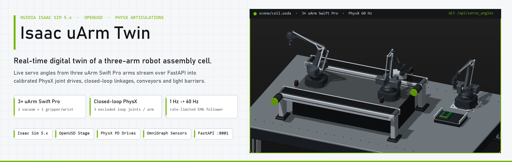
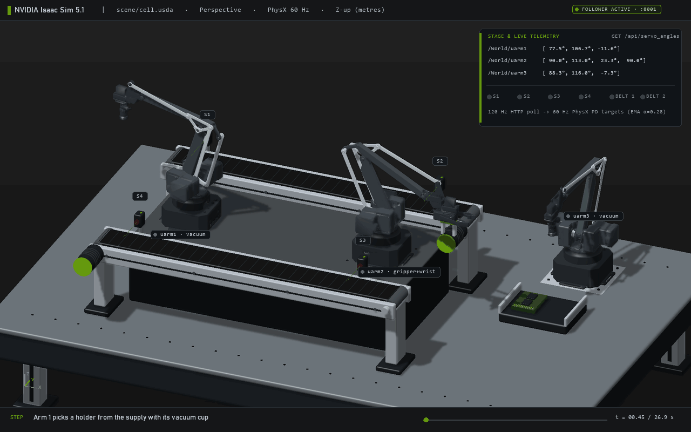
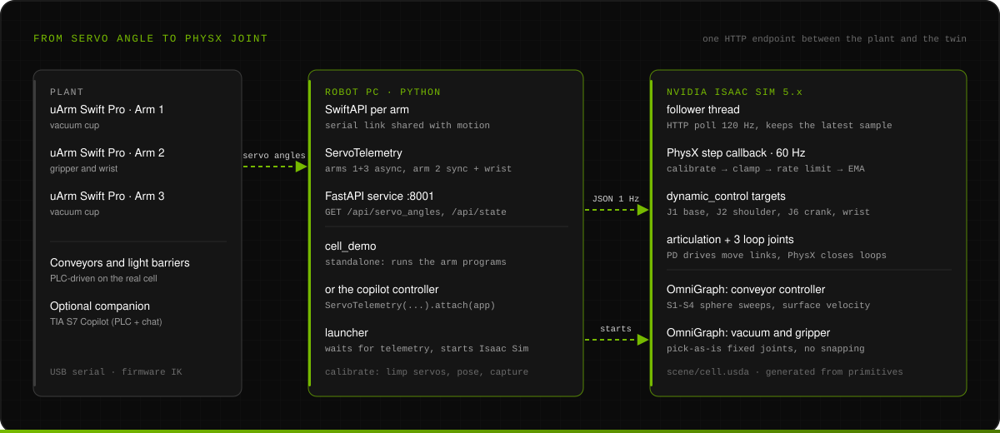
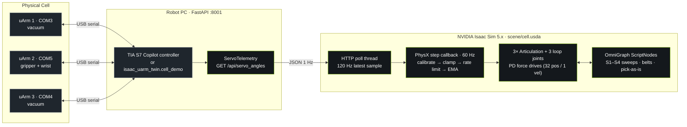
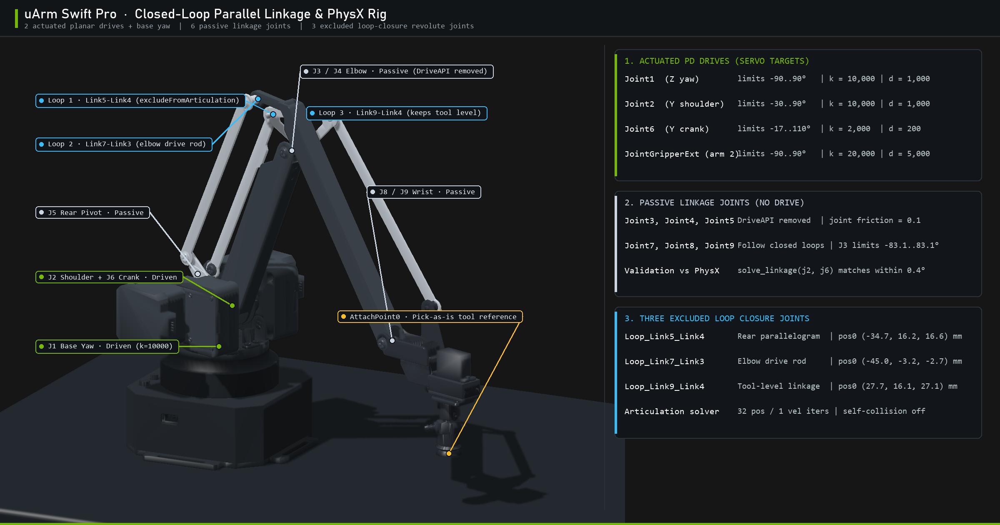
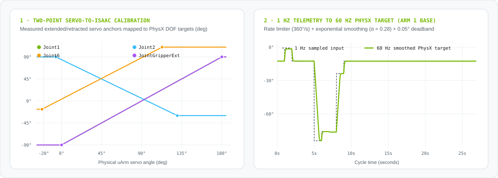

<p align="center">
  <picture>
    <source media="(prefers-color-scheme: dark)" srcset="docs/assets/hero-dark.png">
    
  </picture>
</p>

<p align="center">
  
  
  
  
  
  
  
  
</p>

<p align="center">
  <a href="#one-cycle-in-the-digital-twin"><b>Live cycle</b></a> ·
  <a href="#what-it-does"><b>What it does</b></a> ·
  <a href="#how-it-works"><b>Architecture</b></a> ·
  <a href="#building-the-physics"><b>Physics & rig</b></a> ·
  <a href="#calibration-and-60-hz-smoothing"><b>Calibration</b></a> ·
  <a href="#quick-start"><b>Quick start</b></a> ·
  <a href="#documentation"><b>Docs</b></a>
</p>

**Isaac uArm Twin** is a real-time, physics-driven digital twin of a three-arm PCB assembly cell in **NVIDIA Isaac Sim 5.x**. Live servo angles from three physical **uArm Swift Pro** robots stream over HTTP into calibrated PhysX joint drives, while closed-loop parallel linkages, surface-velocity conveyor belts, sphere-sweep light barriers (`S1`–`S4`) and pick-as-is fixed joints reproduce the complete assembly cycle. It runs standalone or attaches directly to the companion [TIA S7 Copilot](../../../tia-s7-copilot) robot controller.

## One Cycle in the Digital Twin

<p align="center">
  
</p>
<p align="center"><sub>3D mesh replay rendered from the cell's real waypoint programs (<a href="isaac_uarm_twin/sequences.py"><code>sequences.py</code></a>), firmware inverse kinematics and closed-loop linkage solver (<a href="isaac_uarm_twin/kinematics.py"><code>kinematics.py</code></a>). Illustrative software render for documentation · <a href="docs/assets/twin-viewport.png">2400 px high-resolution viewport still</a>.</sub></p>

1. **Infeed pickup (`uarm1`, vacuum):** picks a PCB holder from the supply table and sets it onto Conveyor 1 at light barrier `S1`.
2. **Conveyor 1 transport (`S1` → `S2`):** `S1` latches Belt 1 on (`+0.15 m/s` surface velocity); `S2` stops the holder directly under `uarm2`.
3. **Grip & wrist presentation (`uarm2`, gripper + wrist):** closes on the holder, lifts it, rotates `JointGripperExt` and holds it at the assembly hand-off point.
4. **PCB mounting (`uarm3`, vacuum):** picks a PCB from the tray and releases it onto the held holder pocket.
5. **Outfeed transport (`S3` → `S4`):** `uarm2` places the finished assembly at `S3`, which starts Belt 2 (`-0.15 m/s`) until `S4` stops it at the exit.

## What It Does

<table>
<tr>
<td width="50%" valign="top">
<b>Live servo-to-PhysX following</b><br>
Polls <code>GET /api/servo_angles</code> at 120 Hz and updates PhysX joint position targets on every 60 Hz simulation step through two-point calibration, slew-rate limiting, exponential smoothing ($\alpha = 0.28$) and a $0.05^\circ$ deadband. No inverse kinematics or trajectory planner runs in the loop.
</td>
<td width="50%" valign="top">
<b>Closed-loop parallel linkage rig</b><br>
Each uArm Swift Pro has 9 revolute joints and 3 closed kinematic loops. Only <code>Joint1</code>, <code>Joint2</code>, <code>Joint6</code> (and <code>JointGripperExt</code> on arm 2) carry PD drives; the 6 passive joints follow 3 excluded-from-articulation loop-closure joints solved by PhysX.
</td>
</tr>
<tr>
<td valign="top">
<b>Zero serial-port contention</b><br>
Arms 1 and 3 query servo angles asynchronously with a single-in-flight <code>_pending</code> guard so telemetry never backs up behind blocking motion commands. Arm 2 reads servos 0–2 and appends its software-tracked wrist angle.
</td>
<td valign="top">
<b>Conveyors, light barriers &amp; pick-as-is tools</b><br>
OmniGraph ScriptNodes drive kinematic conveyor belts via <code>PhysxSurfaceVelocityAPI</code>, detect parts with <code>sweep_sphere_all</code> light barriers (<code>S1</code>–<code>S4</code>), and attach parts with pose-preserving fixed joints that never snap or yaw-jump.
</td>
</tr>
<tr>
<td valign="top">
<b>Clean room-scale OpenUSD generator</b><br>
<a href="tools/build_scene.py"><code>tools/build_scene.py</code></a> generates <a href="scene/cell.usda"><code>scene/cell.usda</code></a> (1,702 lines, Z-up, metres) from scratch using primitive colliders and derived waypoint coordinates—no proprietary factory CAD is shipped.
</td>
<td valign="top">
<b>Two-point hardware calibration helper</b><br>
<a href="isaac_uarm_twin/calibrate.py"><code>isaac_uarm_twin.calibrate</code></a> detaches individual servos so an arm can be posed by hand at its extended and retracted stops, captures the physical servo angles and re-engages holding torque.
</td>
</tr>
</table>

## How It Works

<p align="center">
  
</p>



| Stage | Rate | Role |
| :--- | ---: | :--- |
| **Hardware telemetry (`ServoTelemetry`)** | `1 Hz` default | Samples physical servo angles without blocking serial motion commands |
| **Follower HTTP poller (`poll_http`)** | `120 Hz` | Keeps the latest JSON payload in memory; network hiccups hold the last pose |
| **PhysX step callback (`on_physics_step`)** | `60 Hz` | Applies two-point calibration, slew-rate limit, EMA ($\alpha = 0.28$) and $0.05^\circ$ deadband |

## Building the Physics

<p align="center">
  
</p>

The uArm Swift Pro is a closed-loop mechanism, whereas a PhysX articulation must be a tree. [`isaac/tools/rig_swiftpro.py`](isaac/tools/rig_swiftpro.py) configures each imported robot so PhysX solves the real mechanical coupling instead of faking it in code:

| Joint Group | Joints | Axis | Limits (deg) | PhysX Configuration |
| :--- | :--- | :---: | :---: | :--- |
| **Base turret** | `Joint1` | `Z` | `-90 .. +90` | Force PD drive: `k = 10,000`, `d = 1,000`, `maxForce = 1e7`, friction `0.05` |
| **Shoulder** | `Joint2` | `Y` | `-30 .. +90` | Force PD drive: `k = 10,000`, `d = 1,000`, `maxForce = 1e7`, friction `0.05` |
| **Elbow crank** | `Joint6` | `Y` | `-17 .. +110` | Force PD drive: `k = 2,000`, `d = 200`, `maxForce = 1e6`, friction `0.05` |
| **Gripper wrist (arm 2)** | `JointGripperExt` | `Z` | `-90 .. +90` | Force PD drive: `k = 20,000`, `d = 5,000`, `maxForce = 1e5`, friction `0.02` |
| **Passive linkage** | `Joint3`, `4`, `5`, `7`, `8`, `9` | `Y` | `J3: ±83.1` | `DriveAPI` removed; free revolute joints with friction `0.1` |
| **Loop closures** | `Loop_Link5_Link4`, `Loop_Link7_Link3`, `Loop_Link9_Link4` | `Y` | unconstrained | `UsdPhysics.RevoluteJoint` with `excludeFromArticulation = True` |

Checked at `Joint2 = 14.798°` and `Joint6 = 36.026°`, the analytical solver `solve_linkage()` in [`isaac_uarm_twin/kinematics.py`](isaac_uarm_twin/kinematics.py) matches the passive joint angles settled by PhysX (`Joint3 = 21.51°`, `Joint4 = -14.79°`, `Joint5 = 14.81°`, `Joint7 = -21.17°`, `Joint8 = -35.99°`, `Joint9 = 36.06°`) within **0.42°**, and forward kinematics reaches every SDK waypoint in [`sequences.py`](isaac_uarm_twin/sequences.py) within **2.03 mm**.

## Calibration and 60 Hz Smoothing

<picture>
  <source media="(prefers-color-scheme: dark)" srcset="docs/assets/calibration-dark.svg">
  
</picture>

Physical uArm servo readings do not share the same zero or direction as the URDF joint axes (`Joint2` is inverted: `-6.44°` servo corresponds to `+89.954°` in Isaac Sim). Each driven joint is mapped from two measured anchor poses (`servo_ext`, `servo_ret` → `isaac_ext`, `isaac_ret`) captured with [`isaac_uarm_twin.calibrate`](isaac_uarm_twin/calibrate.py):

| Driven DOF | Physical Servo Extended → Retracted | Isaac Sim DOF Extended → Retracted | Slew-Rate Limit |
| :--- | :---: | :---: | ---: |
| `Joint1` (base) | `0.0° → 180.0°` | `-90.0° → +90.0°` | `360°/s` |
| `Joint2` (shoulder) | `-6.44° → 129.966°` | `+89.954° → -29.972°` | `220°/s` |
| `Joint6` (elbow crank) | `-22.0° → 113.0°` | `-17.0° → +110.0°` | `260°/s` |
| `JointGripperExt` (arm 2 wrist) | `180.0° → 0.0°` | `+90.0° → -90.0°` | `200°/s` |

## Quick Start

### 1 · Set up the Python environment and generate the stage

```powershell
py -3.13 -m venv .venv
.\.venv\Scripts\Activate.ps1
python -m pip install -r requirements.txt
python tools/fetch_swiftpro_meshes.py
python tools/build_scene.py
```

Import [`assets/swiftpro/swiftpro_twin.urdf`](assets/swiftpro/swiftpro_twin.urdf) and [`assets/swiftpro/swiftpro_twin_gripper.urdf`](assets/swiftpro/swiftpro_twin_gripper.urdf) with the Isaac Sim URDF Importer, run [`isaac/tools/rig_swiftpro.py`](isaac/tools/rig_swiftpro.py) in the Script Editor and save them to `scene/robot/swiftpro_twin/swiftpro_twin.usd` and `scene/robot/swiftpro_twin_gripper/swiftpro_twin_gripper.usd` (see [docs/building-the-twin.md](docs/building-the-twin.md)).

### 2 · Stream telemetry from the plant (two options)

**Option A — Attach to [TIA S7 Copilot](../../../tia-s7-copilot) (recommended when the PLC cell is running):**

Add two lines to the copilot's `robot_controller.py` before `uvicorn.run(...)` so the process that already owns `COM3`, `COM5` and `COM4` also serves `/api/servo_angles`:

```python
from isaac_uarm_twin.telemetry import ServoTelemetry

ServoTelemetry({"arm1": arm_1, "arm2": arm_2, "arm3": arm_3}).attach(app)
```

**Option B — Standalone cell demo (without the PLC/copilot):**

```powershell
$env:TWIN_RUN_MOTION = "0"   # set to "1" only when the physical cell is clear to run sequences
python -m isaac_uarm_twin.cell_demo
```

### 3 · Launch the Isaac Sim digital twin

```powershell
python -m isaac_uarm_twin.launcher
```

The launcher waits until `GET http://127.0.0.1:8001/api/servo_angles` responds, then starts Isaac Sim with [`isaac/bootstrap.py`](isaac/bootstrap.py), which opens [`scene/cell.usda`](scene/cell.usda), loads [`isaac/follower.py`](isaac/follower.py) into the simulation and presses Play.

> [!CAUTION]
> `cell_demo` runs physical robot motion by default unless `TWIN_RUN_MOTION=0` is set, and `calibrate` can detach holding torque so an arm drops under gravity. Keep the hard-wired emergency stop active and read [SECURITY.md](SECURITY.md) before connecting to hardware.

### Configuration

All settings are read from environment variables or `.env` (see [`.env.example`](.env.example)):

| Variable | Default | Purpose |
| :--- | :--- | :--- |
| `ARM1_PORT` · `ARM2_PORT` · `ARM3_PORT` | `COM3` · `COM5` · `COM4` | Serial ports of the three uArm Swift Pro arms |
| `TWIN_HOST` · `TWIN_PORT` | `127.0.0.1` · `8001` | Bind address and port for the telemetry service |
| `TWIN_TELEMETRY_HZ` | `1.0` | Per-arm servo sampling rate (Hz) |
| `TWIN_RUN_MOTION` | `1` | `1` = run `sequences.py` in `cell_demo`; `0` = telemetry only |
| `TWIN_TELEMETRY_URL` | `http://127.0.0.1:8001/api/servo_angles` | Endpoint polled by `isaac/follower.py` and `launcher.py` |
| `TWIN_CALIBRATION_PORT` | `8002` | Port for `python -m isaac_uarm_twin.calibrate` |
| `ISAAC_SIM_EXE` · `TWIN_SCENE` | `isaacsim` · `scene/cell.usda` | Simulator executable and stage path used by `launcher.py` |

## Project Layout

```text
isaac-uarm-twin/
├── isaac_uarm_twin/
│   ├── telemetry.py             FastAPI /api/servo_angles router (async arms 1 & 3, sync + wrist arm 2)
│   ├── kinematics.py            Swift Pro firmware IK + closed-loop planar linkage solver
│   ├── sequences.py             3-arm assembly waypoint sequences from the physical cell
│   ├── cell_demo.py             standalone runner (sequences + telemetry on :8001)
│   ├── calibrate.py             limp-servo pose capture service (:8002)
│   ├── launcher.py              waits for telemetry, launches Isaac Sim non-blocking
│   └── settings.py              environment / .env configuration
├── isaac/
│   ├── bootstrap.py             opens the stage, loads follower.py and starts Play
│   ├── follower.py              120 Hz HTTP poller + 60 Hz PhysX PD target follower
│   ├── graphs/
│   │   ├── conveyor_controller.py   OmniGraph ScriptNode: S1–S4 sphere sweeps + surface velocity
│   │   └── vacuum_autograb.py       OmniGraph ScriptNode: pose-preserving fixed-joint pickup + UI
│   └── tools/
│       ├── rig_swiftpro.py      configures PD drives, passive joints, 3 loop joints & solver counts
│       ├── surface_gripper.py   alternative Isaac SurfaceGripper suction setup
│       ├── grab_part.py         manual pick-as-is fixed-joint test helper
│       └── release_part.py      manual fixed-joint release helper
├── assets/swiftpro/             URDFs for suction arms (1, 3) and gripper+wrist arm (2)
├── scene/cell.usda              generated Z-up OpenUSD cell stage (1,702 lines)
├── tools/                       scene generator, SHA-256 mesh fetcher & 3D artwork renderer
├── tests/                       196 hardware-free pytest unit & integration tests
└── docs/                        build guide, plant integration, physics & engineering design log
```

## Verification

```bash
python -m pip install -r requirements-dev.txt
python tools/build_scene.py --check
python -m ruff check .
python -m pytest
```

The **196 hardware-free tests** verify:

- two-point calibration anchors, clamping, slew-rate limiting, EMA convergence, deadband and late-arm discovery in `isaac/follower.py`
- non-overlapping async callbacks, wrist tracking, fallback handling and FastAPI routes in `isaac_uarm_twin/telemetry.py`
- closed-loop linkage solver agreement with PhysX passive joint states (`< 0.5°`) and IK→FK tool-tip accuracy (`< 2.5 mm`) across all cell waypoints
- pose-preserving pickup anchor math (`local_hold` and `local_part` coincide without snapping under arbitrary part rotations and stage scales)
- fail-fast bootstrap startup, USDA syntax/target integrity, URDF tree structure and 3D renderer depth-buffer invariants

## Documentation

| Document | Contents |
| :--- | :--- |
| [Building the Twin](docs/building-the-twin.md) | Fetching meshes, URDF import settings, running `rig_swiftpro.py` and first-run checklist |
| [Connecting the Plant](docs/integration.md) | Attaching `ServoTelemetry` to TIA S7 Copilot, JSON payload format and startup behavior |
| [Physics & Calibration](docs/physics.md) | Parallel-linkage constraints, PD gains, two-point calibration, conveyor/sensor physics and limits |
| [Engineering Design Log](docs/design-log.md) | Evolution from ROS 2 / WSL bridges to the final HTTP + PhysX architecture and lessons learned |
| [Reproducing the Artwork](tools/README.md) | Regenerating the 3D mesh renders, animations and calibration charts |
| [Security & Safety](SECURITY.md) | Machine safety, serial port ownership, network exposure and data hygiene |

## License and Provenance

Project-authored code, OpenUSD scene generation and documentation are released under the [MIT License](LICENSE).

- **No proprietary CAD or factory USD assets are included.** The table, riser, conveyors, light barriers and parts in [`scene/cell.usda`](scene/cell.usda) are generated from scratch by [`tools/build_scene.py`](tools/build_scene.py).
- **uArm Swift Pro meshes** (`Base.STL`, `Link1.STL`–`Link9.STL`, `Suction.STL`, `Gripper.STL`) are not redistributed in this repository; [`tools/fetch_swiftpro_meshes.py`](tools/fetch_swiftpro_meshes.py) downloads them from a pinned commit of `uArm-Developer/RosForSwiftAndSwiftPro` and verifies each file's SHA-256 hash. Review upstream licensing notes in [`assets/swiftpro/swiftpro_twin.urdf`](assets/swiftpro/swiftpro_twin.urdf) before redistributing fetched meshes.
- **Visualizations** in `docs/assets/` are deterministic Python software renders produced from the verified public uArm meshes and procedural cell geometry.

NVIDIA, Isaac Sim, Omniverse, PhysX, OpenUSD, uArm and other product names are trademarks of their respective owners. This is an independent project and is not affiliated with or endorsed by any of them.